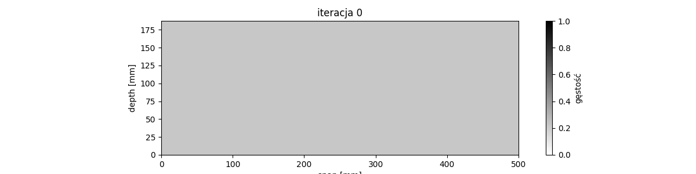
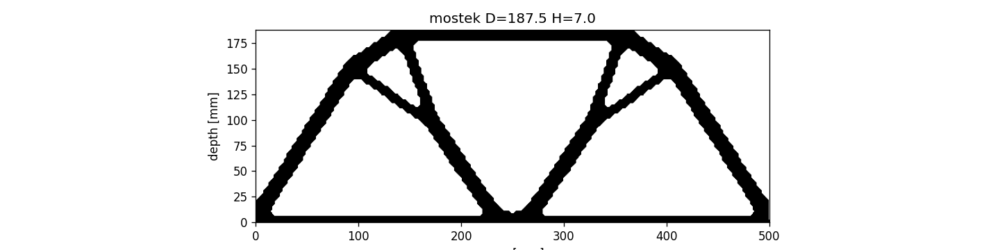
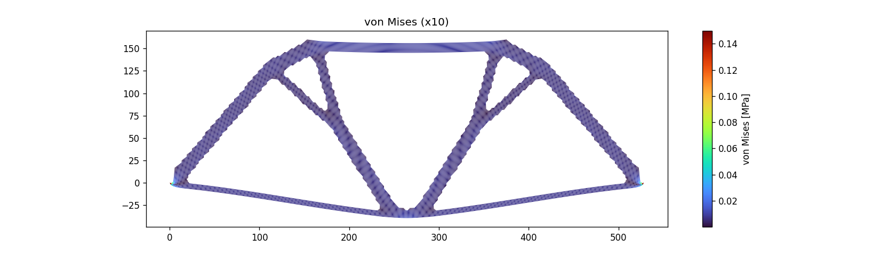
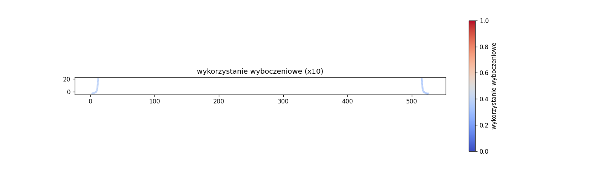
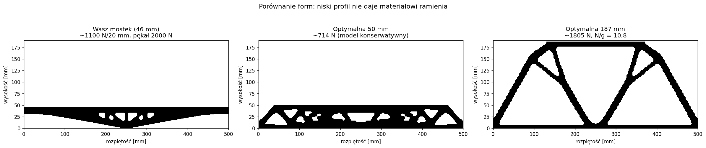

# 🏗️ Kratownica — optymalizator mostka do płaskiego druku 3D

Program generuje **organiczny mostek kratownicowy** pod płaski druk 3D i **maksymalizuje udźwig na gram** (N/g). Zamiast ręcznie projektować kratownicę, optymalizator topologiczny (SIMP) sam „wypala" optymalną formę z fizyki.



## Wynik

| Parametr | Wartość |
|---|---|
| Rozpiętość | 500 mm |
| Głębokość D (wysokość) | **187,5 mm** |
| Wysokość H (płaski druk) | 7 mm |
| Masa (1 dźwigar) | 167 g |
| **Udźwig P_max** | **1805 N** |
| **N/g** | **10,8** |
| Tryb dominujący | naprężenie |

Porównanie z mostkiem, który zajął 3. miejsce na zawodach (420 g / 2800 N / 6,67 N/g):



## Jak to działa

1. **SIMP** — optymalizacja topologiczna na siatce 2D (plane stress, elementy Q4). Cel = minimalizacja podatności (maksymalna sztywność) przy zadanej masie.
2. **Wygładzanie + fillets** — zamknięcie morfologiczne zaokrągla narożniki (ostre kąty w MES nie zbiegają).
3. **Minimum 4 mm** — najwęższy pręt do druku jest wymuszany jako twarda granica.
4. **Weryfikacja** — na zagęszczonej siatce liczone są trzy tryby: **ugięcie**, **naprężenie**, **wyboczenie** (w płaszczyźnie **i** boczne). P_max = minimum z trzech.

### Wizualizacje

**Naprężenia von Misesa** (deformacja ×10):



**Wykorzystanie wyboczeniowe** (czerwony = pręt wybacza się):



**Dlaczego niski mostek przegrywa** (ten sam materiał na małej wysokości nie ma ramienia):



## Uruchomienie

```bash
pip install -r requirements.txt

# pełna optymalizacja (D od 60 do 200 mm, H=7, 180 g na dźwigar)
python run.py --el-size 2.5 --max-iter 80 --mass 180 --workers 10 --deck-load --gif --out out/
```

Najważniejsze flagi:

| Flaga | Opis |
|---|---|
| `--mass` | budżet masy na dźwigar (g) |
| `--deck-load` | obciążenie na jezdni (pas dolny) zamiast pasa górnego |
| `--workers` | liczba procesów (sweep D×H jest równoległy) |
| `--gif` | zapisuje animację powstawania (`powstawanie.gif`) |

Wyniki lądują w `out/`: `mostek.stl` (do slicera), `geometria.png`, `naprezenia_x1/x10.png`, `wyboczenie_x1/x10.png`, `raport.txt`.

## Testy

```bash
python -m pytest -q
```

23 testy — m.in. referencyjne wartości Eulera (147,39 N), ugięcia belki (114,29 mm), min. szerokości 4 mm i zachowanie materiału przy wygładzaniu.

## Struktura

```
truss/
  constants.py   # parametry materiału i konkursu
  mesh.py        # siatka Q4
  fea.py         # plane-stress MES
  topo.py        # SIMP + filtr gęstości
  postprocess.py # próg, fillets, min. szerokość, szkielet
  stl.py         # zapis STL (wokselowy, z otworami)
  verify.py      # ugięcie / naprężenie / wyboczenie
  optimize.py    # pętla D×H, multiprocessing
  report.py      # PNG/STL/txt
  visualize.py   # wykresy naprężeń i wyboczenia
```

## Ostrzeżenie

Model jest **liniowy** — realny wydruk (adhezja warstw, jakość) da **50–70%** wyliczonego udźwigu. Przed zawodami wydrukuj i złam prototyp.
